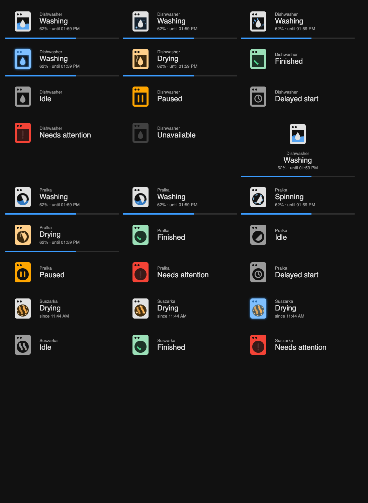
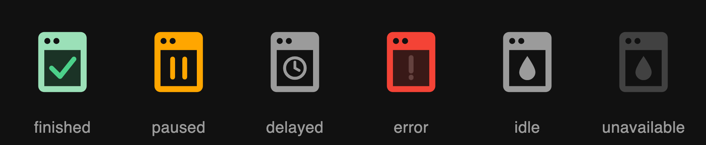
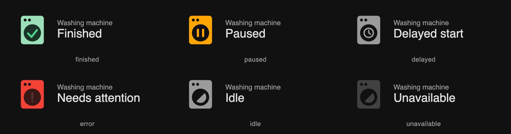
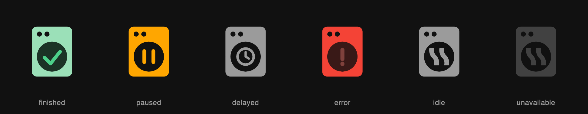
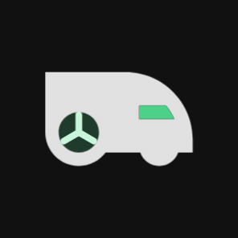
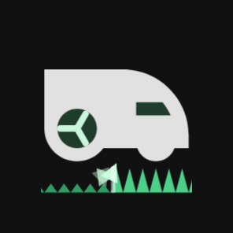
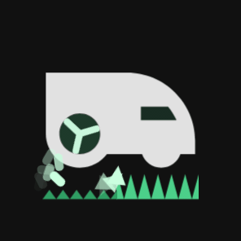
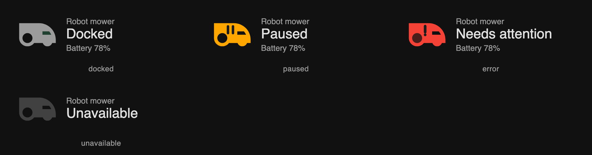

# MDI Animated Appliances

Animated, **Material Design Icon–style** appliance cards for Home Assistant. Pick an entity and the
icon follows the appliance: water moves in the window of a dishwasher, the drum of a washing machine
turns, a tumble dryer glows with moving heat waves, a robot vacuum circles its ring, a robot mower
spins its wheel – and a check draws itself when the cycle is finished.



Supported appliances: **dishwasher**, **washer** (washing machine), **dryer** (tumble dryer), **vacuum** (robot vacuum) and **mower** (robot lawn mower). More to come – pick one with the `appliance` option.

* Pure SVG + CSS, no dependencies, no `card-mod`, no extra resources.
* Built on the real Material Design Icons outlines (`dishwasher`, `washing-machine`, `tumble-dryer`, `robot-vacuum`, `robot-mower`), so it blends in with the rest of your dashboard and theme.
* Washing animations – dishwasher: `wave`, `bubbles`, `drops`, `sway`; washer: `tumble` (rotating drum), `bubbles`, `sway`; dryer: `heat` (glowing drum with moving heat waves, default), `tumble` (items orbiting the drum), `sway`; vacuum: `clean` (arc circling the ring, default), `scan` (radar sweep), `sonar` (expanding rings), `bounce` (body roaming inside the ring), `suction` (dust pulled in), `vortex` (dust spiralling in), `brush` (spinning side brush), `bin` (dust bin filling), `sparkle` (shine on a clean floor), `mop` (water wave), `sway`; mower: `mow` (turning wheel, default), `grass` (cutting line over grass), `clippings` (spinning blade and flying clippings), `shuttle` (drives a row and turns), `cut` (cutting line, falling blade tips), `mulch` (clippings spraying out the back), `deck` (spinning blade, grass pulled in), `meadow` (tall grass and flowers in the wind), `swath` (cut line plus clippings spray), `sway`.
* States: washing / cleaning / mowing, spinning (washer), drying, returning (robots), finished, paused, delayed start, error, idle / docked, unavailable.
* Optional progress bar and finish time for appliances; battery level for robots.
* Visual editor, English and Polish labels, honours `prefers-reduced-motion`.

## Gallery

Every animation is a seamless loop. Static states are shown under each appliance.

### Dishwasher

`appliance: dishwasher`

| | | |
|---|---|---|
| <b>wave (default)</b><br><sub>washing: water moving in the window</sub><br> | <b>bubbles</b><br><sub>washing: bubbles rising</sub><br> | <b>drops</b><br><sub>washing: falling drops</sub><br> |
| <b>sway</b><br><sub>washing: the whole icon sways</sub><br> | <b>drying</b><br><sub>drying phase (`drying_from_progress`): steam</sub><br> |  |

**Other states:** finished · paused · delayed start · needs attention · idle · unavailable



### Washing machine

`appliance: washer`

| | | |
|---|---|---|
| <b>tumble (default)</b><br><sub>wash / rinse: drum swings, water sloshes</sub><br> | <b>bubbles</b><br><sub>wash / rinse: bubbles rising</sub><br> | <b>sway</b><br><sub>wash / rinse: the whole icon sways</sub><br> |
| <b>spinning</b><br><sub>spin: drum spins fast</sub><br> | <b>drying</b><br><sub>drying: steam</sub><br> |  |

**Other states:** finished · paused · delayed start · needs attention · idle · unavailable



### Tumble dryer

`appliance: dryer`

| | | |
|---|---|---|
| <b>heat (default)</b><br><sub>glowing drum, moving heat waves</sub><br> | <b>tumble</b><br><sub>items orbiting the drum</sub><br> | <b>sway</b><br><sub>the whole icon sways</sub><br> |

**Other states:** finished · paused · delayed start · needs attention · idle · unavailable



### Robot vacuum

`appliance: vacuum`

| | | |
|---|---|---|
| <b>clean (default)</b><br><sub>cleaning: arc circles the ring</sub><br> | <b>scan</b><br><sub>cleaning: radar sweep</sub><br> | <b>sonar</b><br><sub>cleaning: expanding rings</sub><br> |
| <b>bounce</b><br><sub>cleaning: body roams inside the ring</sub><br> | <b>suction</b><br><sub>cleaning: dust pulled into the body</sub><br> | <b>vortex</b><br><sub>cleaning: dust spirals in</sub><br> |
| <b>brush</b><br><sub>cleaning: side brush sweeps dust</sub><br> | <b>bin</b><br><sub>cleaning: the dust bin fills up</sub><br> | <b>sparkle</b><br><sub>cleaning: shine on a clean floor</sub><br> |
| <b>mop</b><br><sub>mopping: water wave in the body</sub><br> | <b>sway</b><br><sub>cleaning: the whole icon sways</sub><br> | <b>returning</b><br><sub>returning to the dock: amber, slower, reversed</sub><br> |

**Other states:** docked · paused · needs attention · unavailable


### Robot mower

`appliance: mower`

| | | |
|---|---|---|
| <b>mow (default)</b><br><sub>mowing: wheel turns, light pulses</sub><br> | <b>grass</b><br><sub>mowing: cutting line over grass</sub><br> | <b>clippings</b><br><sub>mowing: spinning blade, flying clippings</sub><br> |
| <b>cut</b><br><sub>mowing: cutting line, blade tips fall</sub><br> | <b>mulch</b><br><sub>mowing: clippings spray from the back</sub><br> | <b>deck</b><br><sub>mowing: spinning blade, grass pulled in</sub><br> |
| <b>meadow</b><br><sub>mowing: tall grass and flowers sway</sub><br> | <b>swath</b><br><sub>mowing: cutting line plus clippings spray</sub><br> | <b>shuttle</b><br><sub>mowing: drives a row and turns</sub><br> |
| <b>sway</b><br><sub>mowing: the whole icon sways</sub><br> | <b>returning</b><br><sub>returning to the dock: amber</sub><br> |  |

**Other states:** docked · paused · needs attention · unavailable



## Installation

### HACS (custom repository)

1. HACS → ⋮ → **Custom repositories**.
2. Repository: `https://github.com/bglowacki/mdi-animated-appliances`, type **Dashboard**.
3. Install **MDI Animated Appliances** and reload the browser.

HACS registers the resource automatically. For a manual install copy `dist/mdi-animated-appliances.js` to
`/config/www/` and add the resource `/local/mdi-animated-appliances.js` (type *JavaScript module*).

## Usage

Add a card → **MDI Animated Appliances**, choose the entity, done. Or in YAML:

```yaml
type: custom:mdi-animated-card
appliance: dishwasher
entity: sensor.kitchen_dishwasher_operation_state
progress_entity: sensor.kitchen_dishwasher_program_progress      # optional, 0–100
finish_entity: sensor.kitchen_dishwasher_program_finish_time     # optional, timestamp
variant: wave
```

### Options

| Option | Default | Description |
|---|---|---|
| `entity` | – | **Required.** Entity carrying the appliance status (see *Supported entities*). |
| `appliance` | `dishwasher` | `dishwasher`, `washer`, `dryer`, `vacuum` or `mower`. |
| `name` | entity name | Card title. |
| `variant` | `wave` / `tumble` / `heat` | Dishwasher: `wave`, `bubbles`, `drops`, `sway`. Washer: `tumble`, `bubbles`, `sway`. Dryer: `heat`, `tumble`, `sway`. Vacuum: `clean`, `scan`, `sonar`, `bounce`, `suction`, `vortex`, `brush`, `bin`, `sparkle`, `mop`, `sway`. Mower: `mow`, `grass`, `clippings`, `shuttle`, `cut`, `mulch`, `deck`, `meadow`, `swath`, `sway`. |
| `progress_entity` | – | Numeric 0–100 sensor; shows a bar and a percentage (appliances, not robots). |
| `finish_entity` | – | Timestamp sensor; shows “until HH:MM” (appliances, not robots). |
| `battery_entity` | `battery_level` attribute | Battery sensor for `vacuum` / `mower`; shows “Battery 78%”. |
| `drying_from_progress` | – | Show the *drying* animation once progress reaches this % (for integrations that do not report a drying phase). |
| `state_map` | – | Map raw states to `washing`, `drying`, `finished`, `paused`, `delayed`, `error`, `idle`. |
| `layout` | `horizontal` | `horizontal` or `vertical`. |
| `icon_size` | `72` | Icon size in px. |
| `show_progress` | `true` | Show progress bar and percentage. |
| `show_finish_time` | `true` | Show finish time. |
| `language` | HA language | `en` or `pl`. |
| `tap_action` | `more-info` | Standard Home Assistant action object. |

A tumble dryer on a smart plug (no cycle status) works with any on/off entity – e.g. a binary sensor that is `on`
while the dryer draws power. The card then shows “since HH:MM”:

```yaml
type: custom:mdi-animated-card
appliance: dryer
entity: binary_sensor.dryer_running
```

Robots (`vacuum.*` and `lawn_mower.*` entities – states `cleaning`/`mowing`, `returning`, `docked`, `paused`, `error`).
The card shows the battery (from the `battery_level` attribute, or set `battery_entity`):

```yaml
type: custom:mdi-animated-card
appliance: vacuum        # or: mower
entity: vacuum.my_robot  # or: lawn_mower.my_mower
battery_entity: sensor.my_robot_battery   # optional
```

### Supported entities

* `sensor` with an operation state – recognised out of the box: Home Connect (`run`, `finished`,
  `inactive`, `ready`, `pause`, `delayedstart`, `actionrequired`, `error`), and generic words such as
  `washing`, `drying`, `done`, `idle`.
* Washing machines (e.g. LG ThinQ `job_state`): `wash`, `rinse`, `spin`, `drying`, `finish`, `delay_wash`, `none`, and
  `machine_state` (`run`, `pause`, `stop`).
* `switch`, `input_boolean`, `binary_sensor`: `on` is shown as washing, `off` as idle.
* Anything else: use `state_map`, e.g.

```yaml
state_map:
  cycle_main: washing
  cycle_dry: drying
```

## Development

```
npm test                 # state-mapping unit tests (node:test)
python3 -m http.server   # then open /test/harness.html to see every state and variant
```

## Credits and license

MIT – see [LICENSE](LICENSE). The dishwasher outline is from
[Material Design Icons](https://pictogrammers.com/library/mdi/) (Apache-2.0), see [NOTICE](NOTICE).
