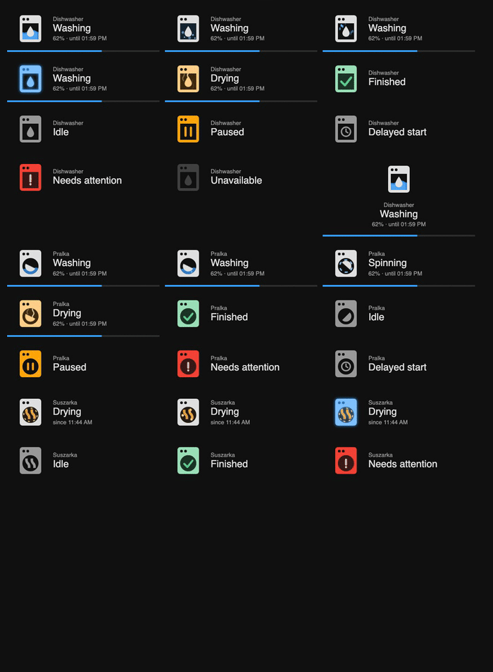

# MDI Animated Appliances

Animated, **Material Design Icon–style** appliance cards for Home Assistant. Pick an entity and the
icon follows the appliance: water moves in the window while washing, steam rises while drying, a check
draws itself when the cycle is finished.



Supported appliances: **dishwasher**, **washer** (washing machine) and **dryer** (tumble dryer). More to come – pick one with the `appliance` option.

* Pure SVG + CSS, no dependencies, no `card-mod`, no extra resources.
* Uses the real `mdi:dishwasher` outline so it blends in with the rest of your dashboard and theme.
* Washing animations – dishwasher: `wave`, `bubbles`, `drops`, `sway`; washer: `tumble` (rotating drum), `bubbles`, `sway`; dryer: `heat` (glowing drum with moving heat waves, default), `tumble` (items orbiting the drum), `sway`.
* States: washing, spinning (washer), drying, finished, paused, delayed start, error, idle, unavailable.
* Optional progress bar and finish time.
* Visual editor, English and Polish labels, honours `prefers-reduced-motion`.

## Installation

### HACS (custom repository)

1. HACS → ⋮ → **Custom repositories**.
2. Repository: `https://github.com/bglowacki/mdi-animated-appliances`, type **Dashboard**.
3. Install **MDI Animated Appliances** and reload the browser.

HACS registers the resource automatically. For a manual install copy `dist/mdi-animated-appliances.js` to
`/config/www/` and add the resource `/local/mdi-animated-appliances.js` (type *JavaScript module*).

## Usage

Add a card → **MDI Animated Appliances**, choose the entity, done. Or in YAML:

```yaml
type: custom:mdi-animated-card
appliance: dishwasher
entity: sensor.kitchen_dishwasher_operation_state
progress_entity: sensor.kitchen_dishwasher_program_progress      # optional, 0–100
finish_entity: sensor.kitchen_dishwasher_program_finish_time     # optional, timestamp
variant: wave
```

### Options

| Option | Default | Description |
|---|---|---|
| `entity` | – | **Required.** Entity carrying the appliance status (see *Supported entities*). |
| `appliance` | `dishwasher` | `dishwasher`, `washer` or `dryer`. |
| `name` | entity name | Card title. |
| `variant` | `wave` / `tumble` / `heat` | Dishwasher: `wave`, `bubbles`, `drops`, `sway`. Washer: `tumble`, `bubbles`, `sway`. Dryer: `heat`, `tumble`, `sway`. |
| `progress_entity` | – | Numeric 0–100 sensor; shows a bar and a percentage. |
| `finish_entity` | – | Timestamp sensor; shows “until HH:MM”. |
| `drying_from_progress` | – | Show the *drying* animation once progress reaches this % (for integrations that do not report a drying phase). |
| `state_map` | – | Map raw states to `washing`, `drying`, `finished`, `paused`, `delayed`, `error`, `idle`. |
| `layout` | `horizontal` | `horizontal` or `vertical`. |
| `icon_size` | `72` | Icon size in px. |
| `show_progress` | `true` | Show progress bar and percentage. |
| `show_finish_time` | `true` | Show finish time. |
| `language` | HA language | `en` or `pl`. |
| `tap_action` | `more-info` | Standard Home Assistant action object. |

A tumble dryer on a smart plug (no cycle status) works with any on/off entity – e.g. a binary sensor that is `on`
while the dryer draws power. The card then shows “since HH:MM”:

```yaml
type: custom:mdi-animated-card
appliance: dryer
entity: binary_sensor.dryer_running
```

### Supported entities

* `sensor` with an operation state – recognised out of the box: Home Connect (`run`, `finished`,
  `inactive`, `ready`, `pause`, `delayedstart`, `actionrequired`, `error`), and generic words such as
  `washing`, `drying`, `done`, `idle`.
* Washing machines (e.g. LG ThinQ `job_state`): `wash`, `rinse`, `spin`, `drying`, `finish`, `delay_wash`, `none`, and
  `machine_state` (`run`, `pause`, `stop`).
* `switch`, `input_boolean`, `binary_sensor`: `on` is shown as washing, `off` as idle.
* Anything else: use `state_map`, e.g.

```yaml
state_map:
  cycle_main: washing
  cycle_dry: drying
```

## Development

```
npm test                 # state-mapping unit tests (node:test)
python3 -m http.server   # then open /test/harness.html to see every state and variant
```

## Credits and license

MIT – see [LICENSE](LICENSE). The dishwasher outline is from
[Material Design Icons](https://pictogrammers.com/library/mdi/) (Apache-2.0), see [NOTICE](NOTICE).
